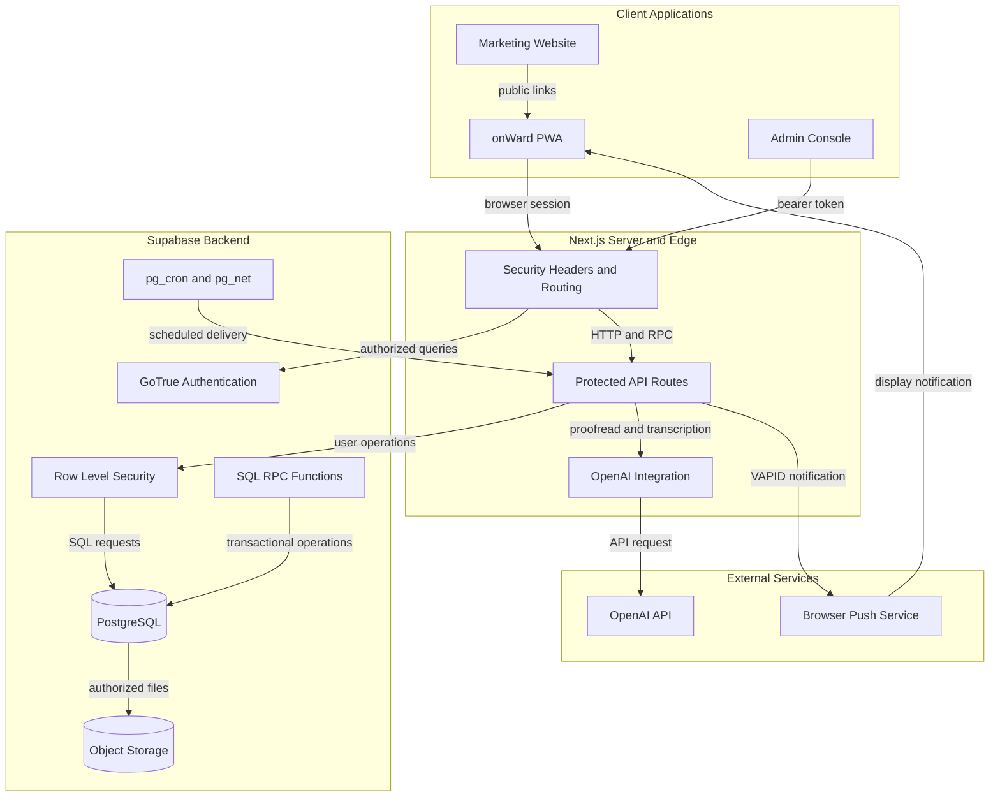
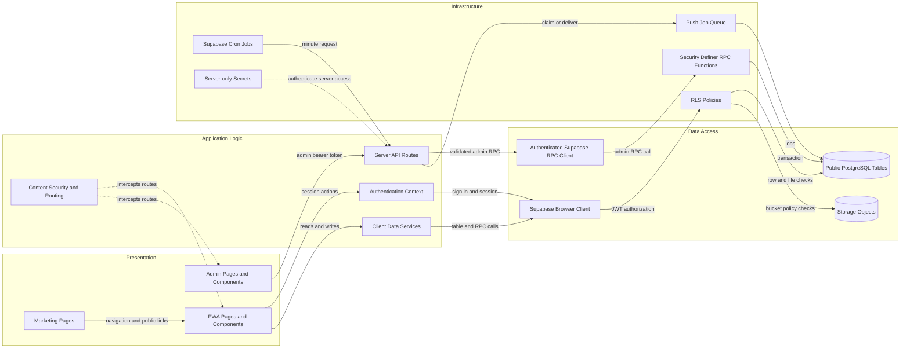

# Architecture Diagram

onWard is a three-application Next.js platform backed by one Supabase project. Supabase combines identity, PostgreSQL data, row-level authorization, Storage, RPC functions, and scheduled database operations.

## Application Architecture

<!-- mermaid-checked: no \n, no em-dash/en-dash, no {} in labels, subgraphs are id["label"], arrows are -->|"label"|, all subgraphs closed by end, ids unique -->

### Technology Stack Summary

| Layer | Technology | Version | Purpose |
|---|---|---|---|
| PWA | Next.js, React, TypeScript | Next.js 15, React 19 | Daily tracking, social, network, CV, and portfolio features |
| Admin | Next.js, React, TypeScript | Next.js 15, React 19 | Platform administration and broadcast control |
| Website | Next.js, React, TypeScript | Next.js 15, React 19 | Public marketing and legal content |
| Styling | Tailwind CSS | 3.4 | Shared responsive application styling |
| Identity | Supabase Auth | 2.118 client | Sessions, OAuth, account verification, and JWTs |
| Database | Supabase PostgreSQL | Managed | Application records, joins, indexes, and transactions |
| Access control | Supabase RLS and RPC | PostgreSQL policies | Enforces ownership and participant permissions |
| Files | Supabase Storage | Managed buckets | Public media and private evidence or message files |
| Scheduling | pg_cron, pg_net, Vault | Supabase extensions | Periodic push-job processing |
| External AI | OpenAI API | Server route key | Proofreading and transcription |

### Data Storage & External Services

PostgreSQL stores profiles, tasks, notes, onWards, skills, evidence records, activity, settings, shares, social content, communities, connections, messages, push jobs, subscriptions, and rate-limit state. Supabase Storage holds public post and community media plus private ward evidence and direct-message media. RLS authorizes normal database and Storage access, while SQL RPC functions centralize compound operations and admin authorization. OpenAI and browser push providers are external integrations called only from protected server routes.

### Key Architectural Decisions

- The browser uses the Supabase publishable key and authenticated JWT; RLS remains the final access boundary for tables and Storage.
- Service-role access is reserved for server routes and operational functions that intentionally bypass RLS.
- Database migrations provide the source of truth for schema, ownership policies, storage buckets, RPC functions, and scheduled delivery setup.

## Component Relationships

<!-- mermaid-checked: no \n, no em-dash/en-dash, no {} in labels, subgraphs are id["label"], arrows are -->|"label"|, all subgraphs closed by end, ids unique -->

### Component Inventory

| Component | Layer | Type | Responsibility |
|---|---|---|---|
| PWA pages | Presentation | React and Next.js routes | User-facing planning, work, social, network, and profile flows |
| Admin pages | Presentation | React and Next.js routes | Metrics, users, feedback, support, broadcasts, and automations |
| Marketing pages | Presentation | React and Next.js routes | Public product, pricing, policy, and contact content |
| Authentication context | Application logic | React context | Manages Supabase sign-in, sessions, and identity state |
| Data services | Application logic | TypeScript service module | Executes table, Storage, and RPC operations |
| Protected API routes | Application logic | Next.js server routes | Validates secrets, bearer tokens, rate limits, and external integrations |
| Supabase browser client | Data access | Supabase SDK | Sends authenticated Data API and Realtime requests |
| PostgreSQL tables | Data access | Managed database | Stores relational application state |
| Storage buckets | Data access | Object storage | Stores public and private uploaded files |
| RLS policies | Infrastructure | PostgreSQL policies | Filters rows and object access by identity and ownership |
| RPC functions | Infrastructure | PostgreSQL functions | Provides compound and elevated server operations |
| Cron jobs | Infrastructure | Supabase scheduled tasks | Triggers push automation and queue processing |
| Push queue | Infrastructure | PostgreSQL tables | Stores and claims due notification jobs |
