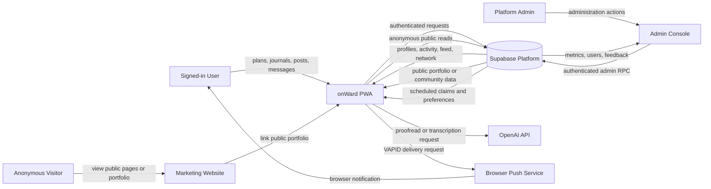
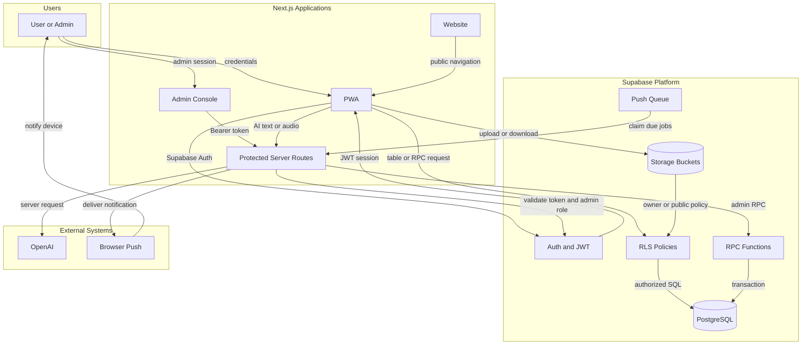
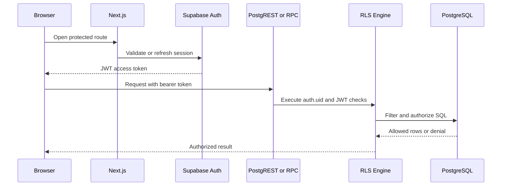
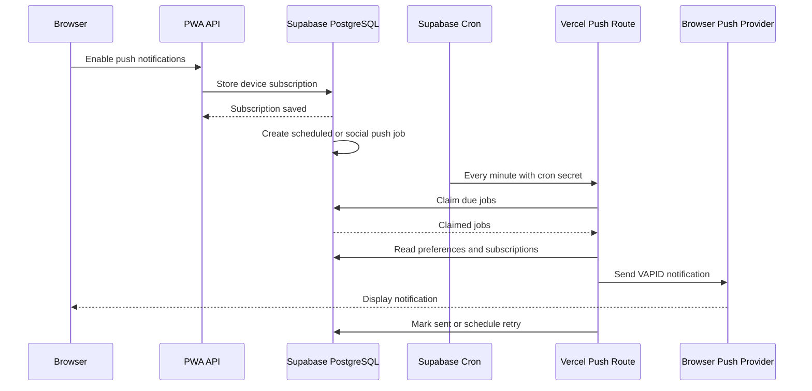
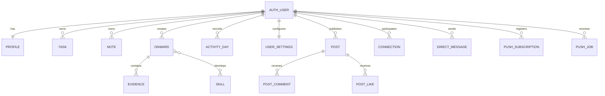

# Supabase Use Case and Data Flows

onWard uses Supabase as an application backend platform, not just a database. It centralizes identity, relational data, authorization, file storage, server functions, realtime subscriptions, scheduling, rate limits, and push-job state.

## Responsibility boundary

| Concern | Supabase handles | onWard application handles |
|---|---|---|
| Sign-in | OAuth, email authentication, JWT issuance, sessions | Sign-in UI, account routing, session context |
| Authorization | RLS policies and JWT claims | UX rules and route-level checks |
| Data | PostgreSQL tables, indexes, triggers, constraints | Data-shaped TypeScript services and domain flows |
| Compound operations | PostgreSQL RPC functions | Request orchestration and result presentation |
| Files | Buckets, object paths, MIME limits, Storage policies | Upload, preview, sharing, and deletion flows |
| Background work | pg_cron, pg_net, Vault, push queue | Cron authorization, VAPID delivery, retry handling |
| External AI | No direct integration | Server-only OpenAI routes |
| Push delivery | Subscription and job persistence | Browser subscription API and Web Push delivery |

## Data Flow Diagram - Level 0

<!-- mermaid-checked: no \n, no em-dash/en-dash, no {} in labels, subgraphs are id["label"], arrows are -->|"label"|, all subgraphs closed by end, ids unique -->

## Data Flow Diagram - Level 1

<!-- mermaid-checked: no \n, no em-dash/en-dash, no {} in labels, subgraphs are id["label"], arrows are -->|"label"|, all subgraphs closed by end, ids unique -->

## Authentication and authorization sequence

<!-- mermaid-checked: no \n, no em-dash/en-dash, no {} in labels, subgraphs are id["label"], arrows are -->|"label"|, all subgraphs closed by end, ids unique -->

## Push notification sequence

<!-- mermaid-checked: no \n, no em-dash/en-dash, no {} in labels, subgraphs are id["label"], arrows are -->|"label"|, all subgraphs closed by end, ids unique -->

## Core data model

<!-- mermaid-checked: no \n, no em-dash/en-dash, no {} in labels, subgraphs are id["label"], arrows are -->|"label"|, all subgraphs closed by end, ids unique -->

## Supabase services used by onWard

### Authentication

Supabase Auth owns email and OAuth account identity. Next.js receives and stores the resulting session, and PostgreSQL receives the JWT through authenticated Supabase Data API requests. The initial profile is linked to `auth.users.id`, so deleting an account cascades to owned application records.

### PostgreSQL and RLS

PostgreSQL stores the relational state and enforces constraints, indexes, triggers, and cascading deletes. RLS is the primary browser authorization boundary. Policies compare `auth.uid()` with profile IDs or `user_id` columns, enforce participant membership for conversations, and permit public access only for explicitly shareable records.

This protects direct browser access: the publishable key identifies the project, the JWT identifies the user, and RLS decides whether a query can read or mutate a row.

### RPC functions

RPC functions handle operations that require coordinated database logic or elevated context:

- Activity recording and leaderboard calculation
- Connection requests and direct conversations
- Public portfolio and community access
- Search and network catch-up
- Poll voting
- Admin metrics and push automation updates
- Push-job claiming and automated job scheduling

### Storage

Supabase Storage separates public and private content:

| Bucket | Access | Typical use |
|---|---|---|
| `post-media` | Public | Images and video attached to Exchange posts |
| `community-media` | Public | Community profile and banner media |
| `ward-evidence` | Private | Images, PDFs, documents, and presentation evidence |
| `direct-message-media` | Private | Participant-only files in direct conversations |

Storage policies limit upload ownership by user-folder path. Private buckets require authorization and appropriate participant or owner policies.

### pg_cron and push jobs

Supabase Cron calls the Next.js push route once per minute. The route uses a cron secret, claims jobs with `SKIP LOCKED`, validates notification preferences, reads subscriptions, sends VAPID notifications, removes expired subscriptions, and updates retries or completion state.

This removes timing and retry coordination from the browser. The browser only registers a device; Supabase stores schedules and the server route performs delivery.

## What complexity Supabase replaces

Without Supabase, onWard would need separate services or substantial implementation for:

- Password, OAuth, account, and JWT lifecycle
- Auth middleware and session refresh
- PostgreSQL hosting and connection management
- API-to-database serialization
- Row ownership and cross-user authorization
- Private and public file storage APIs
- Object upload, MIME, size, and path policies
- Transactional SQL functions and concurrency-safe job claims
- Scheduled HTTP jobs and secret storage
- Push subscription persistence and delivery retry state

Supabase does not eliminate application security work. Environment secrets, RLS policy review, migration correctness, rate limiting, Storage policies, and privileged route authorization remain explicit engineering responsibilities.
